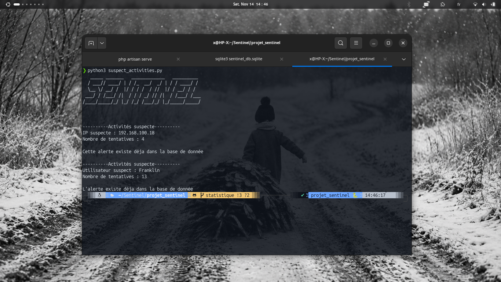

# Première version de sentinel

## Fonctionnalité implémenté :

- Utilisateurs : CRUD des utilisateurs
- Connexions : CRUD des journaux de connexion	
- Détection	Détection des IP et utilisateurs suspect
- Alertes	Consultation, suppression et gestion des statuts
- Statistiques	Total, connexions réussies et échouées

Les classes, méthodes et fonctions Python.
### SQLITE
Utilisation & apprentissage des notions telles que : **INSERT, SELECT, UPDATE, DELETE, COUNT, GROUP BY, HAVING.**
### Les curseurs

> ***fetchone(), fetchall(), commit() et rowcount.***
### Module & Import en Python

- Les paramètres SQL ? pour éviter de concaténer directement les données.
- Les conditions, les boucles et les tuples.
- La gestion des dates avec datetime.
- La récupération d'informations réseau avec socket.

## Base de donnée SQLITE via le CLI

## Rapports

## Détection des activités suspectes

